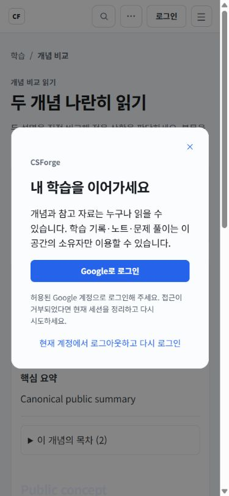
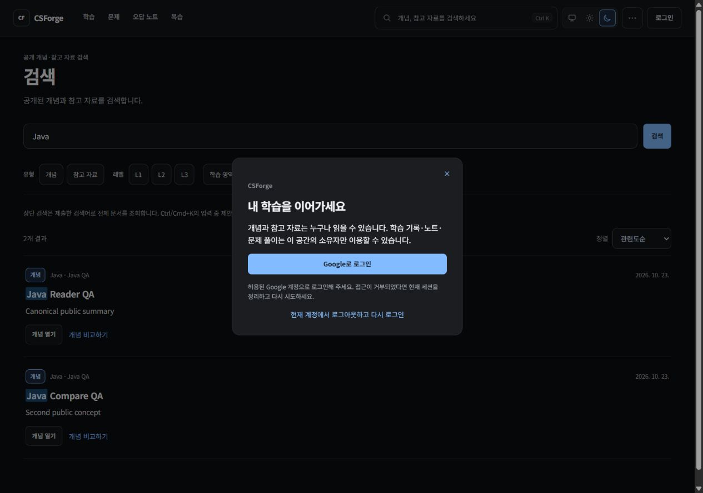

# Issue #270 구현 및 검증 보고서

기준일: 2026-10-23 (Asia/Seoul). 요구사항: [Issue #270](https://github.com/guseoh/csforge/issues/270).

## 작업 기준과 변경 범위

- 원격 main을 조회하고 fetch하여 `b52e0c768f9df3570805eae23f93d131afb6c87d`를 확인했다.
- 최초 체크아웃은 `codex/issue-222-r2-remaining45-reconcile`이었다. 해당 브랜치의 기존 커밋과 미추적 `backend/bin/`을 보존하고, 최신 main의 detached HEAD에서 구현했다. 이후 사용자가 보존·전체 재검증·refactor 통합·커밋·리뷰·push/CI를 승인했다. Production 병합은 검증 결과를 바탕으로 판단하며 별도 승인 전 실행하지 않는다.
- single-user, Google 소유자 한 계정, LOCAL 무인증 정책을 유지했다. Member/userId/새 provider/의존성/DB migration/운영 DB 변경은 없다.
- [변경 파일 전체 목록](changed-files.txt). 기존 미추적 `backend/bin/`은 이 목록에서 제외했다.

## 후속 보존·브랜치 통합

- detached 변경과 기존 보고서·무시된 검증 로그를 포함한 68개 파일을 외부 작업 산출물 디렉터리 `issue270-preservation`에 ZIP, binary patch, SHA-256 manifest로 보존했다. Git 이력은 `history.bundle`로 보존하고 `git bundle verify`를 통과했다.
- fetch 후 main은 `b52e0c768f9df3570805eae23f93d131afb6c87d`, refactor는 `05d67b7bfb13282379eba0d246048dc22459f348`이었다. main 전용 4개/refactor 전용 84개 커밋으로 분기했지만 양쪽 tree는 `f431ddd66ecef4b5e8c2a31995f725645b771707`로 동일했다.
- 로컬 refactor를 원격 refactor에서 만들고 main을 이력 보존 merge했다. 통합 커밋은 `d26240cb9c707c7d907092a552bc4aa319abc3c8`이며 양쪽 HEAD를 부모로 가진다. 통합 후에도 baseline tree와 백업한 68개 파일의 SHA-256이 동일함을 확인했다. reset/force-push/브랜치 삭제는 하지 않았다. [통합 증거](branch-integration.json).
- 로컬 Git 작성자 설정이 없어 기존 refactor 커밋의 `guseoh <81723538+guseoh@users.noreply.github.com>`를 명령 단위로 사용했다. 전역/저장소 설정은 변경하지 않았다.
- Backend 전체 `gradlew.bat test --no-daemon` 재실행이 26분 39초 후 exit 0으로 완료됐다. 50 suites, 171 tests 중 170 통과 / 실패·오류 0 / 수동 성능 감사 1 skip이다. 최초 실패·범위 한정 성공 증거를 덮어쓰지 않고 [새 전체 집계](backend-full-rerun-summary.json)에 별도 보존했다. 집계에는 전체 로그의 SHA-256도 포함했다.

## Task 순서별 결과

| 순서 | 구현 결과 | 주요 변경 파일 |
|---|---|---|
| 1. Backend | 공개 canonical 조회용 application view·API DTO·JPA 조회를 분리했다. 공개 검색·추천·상태는 Concept/Reference로 제한한다. 개인 API 보호와 CSRF·세션 정책을 유지한다. | `backend/.../publiccontent/{api,application,infrastructure}/`, `search/api/PublicSearch*`, `SearchQueryService`, `SearchQueryGateway`, `JpaSearchQueryGateway`, `AuthController`, `CloudSecurityConfiguration` |
| 2. Frontend | 세션을 먼저 확인한 뒤 게스트 홈·영역·Reader와 기존 소유자 화면을 분기한다. 게스트 화면은 개인 컴포넌트를 마운트하지 않는다. 비교·검색·팔레트의 API와 query key도 공개/개인 범위로 분리한다. | `frontend/src/router.tsx`, `components/AuthGate.tsx`, `pages/PublicLearningPages.tsx`, `pages/ConceptComparePage.tsx`, `pages/SearchPage.tsx`, `components/SearchPalette.tsx`, `lib/{access,access-context,public-api,search-api}.ts` |
| 3. 로그인 모달 | 상단 로그인·보호 링크·개인 CTA에서 기존 화면 위 모달을 연다. Google만 제공하며 원래 path/search/hash를 기존 TTL·검증을 거쳐 저장한다. 닫기·ESC·외부 클릭·포커스 순환/복귀·스크롤 잠금·로딩/실패·계정 재설정을 제공한다. | `components/LoginModal.tsx`, `auth.css`, `pages/LoginPage.tsx`, `components/AuthGate.tsx`, `router.tsx` |
| 4. 통합 검증 | 아래 자동 검사 및 격리 브라우저 검증을 수행했다. 원격 CI와 실제 Google 계정 승인까지의 확인은 별도로 남긴다. | 인증 통합 테스트, 공개 페이지/경로 테스트, 기존 Search/Compare 테스트, 이 디렉터리의 증거 파일 |

## 공개/개인 API 계약

- 익명 GET 허용 경로를 명시했다: `/api/auth/session`, `/api/public/learning-areas`, `/api/public/learning-areas/{slug}`, 해당 `/outline`, `/api/public/concepts`, `/api/public/concepts/{id}`, `/api/public/search` 및 `/suggestions`, `/filter-options`, `/status`.
- `/api/**` 전체나 `/api/public/**` 전체를 허용하지 않는다. 공개 경로의 POST/PATCH/PUT/DELETE도 익명 허용 대상이 아니다. 기존 CSRF 검사를 유지하므로 토큰 없는 변경 요청은 CSRF 단계에서 거절될 수 있다.
- 공개 커리큘럼은 active Area/Topic과 PUBLISHED Concept만 사용한다. 상세 응답에 progress/personalNote가 없고, 목록·집계에 진도·정확도·최근 열람·노트 정보가 없다. 공개 조회 서비스는 개인 저장소를 주입받지 않는다.
- 목록은 크기 1~100, 최대 offset 10,000, 커리큘럼/제목/갱신 시각의 안정적인 순서를 지원한다. 개인 열람 순 정렬은 공개 API에서 거절한다.
- 공개 검색의 허용 타입은 서버에서 CONCEPT/REFERENCE로 고정한다. 개인 타입을 지정하면 400이며, 추천 후보도 중복 제거 전에 공개 범위로 제한한다. 비공개 Concept에만 연결된 Reference 관계 설명은 검색에 포함되지 않는다.
- Cloud 게스트와 비허용/미검증 identity의 session 응답은 `authenticated:false, mode:CLOUD, email:null`이다. 검증된 소유자만 true다. LOCAL은 기존 true 응답을 유지한다.
- 소유자용 기존 API 응답은 변경하지 않았다. 로그아웃은 세션 종료 후 진행 중인 Query를 취소하고 캐시를 비운 뒤 게스트 홈으로 이동한다. 개인 화면은 언마운트하고 팔레트의 개인 상태도 초기화한다. 기존 노트 초안/저장된 세트는 게스트 화면에서 읽지 않는다.

## 자동 검증

| 검사 | 결과 |
|---|---|
| Backend 최초 `gradlew.bat compileJava --no-daemon` | 통과 |
| Backend 최초 Cloud 인증 통합 검사 | 통과 |
| Backend 전체 `gradlew.bat build --no-daemon` | 50 suites, 171 tests: 160 통과 / 줄바꿈 관련 10 실패 / 1 skip. [최초 집계](backend-full-summary.json) |
| Backend 수정 후 범위 한정 `gradlew.bat test --tests ...` | 12 suites, 23 tests 전부 통과. Cloud 11개 + LOCAL 2개 + 보정한 콘텐츠 테스트 10개. [최종 집계](backend-focused-summary.json) |
| Backend 전체 재실행 `gradlew.bat test --no-daemon` | **BUILD SUCCESSFUL**, 50 suites / 171 tests: **170 통과, 실패·오류 0, 1 skip**. 26분 39초. [전체 재검증 집계](backend-full-rerun-summary.json) |
| Backend 최종 `gradlew.bat assemble --no-daemon` (분리된 build/cache 사용) | 실행 JAR 및 일반 JAR 빌드 통과 |
| Frontend `npm test` | 67 files, 326 tests 통과 |
| Frontend 최종 변경 후 대상 Vitest 검사 | 공개 페이지·Search·Compare·접근 경로·로그인 복귀 5 files, 42 tests 통과 |
| Frontend 최종 `npm run build` | TypeScript·Vite·PWA 빌드 통과 |
| Frontend 최종 `npm run lint` | 통과 |
| `docker compose config --quiet` | 통과 |
| 비밀번호를 지정한 production Compose config | 통과 |
| 비밀번호 없는 production Compose config | 예상대로 실패하여 누락된 필수 비밀번호 거절 확인 |
| `git diff --check` | 통과 |

건너뛴 `DailyRouteQueryAuditTest`는 `CSFORGE_PERF_AUDIT=1`일 때만 실행되는 수동 성능 감사이다. 이번 실행에서 해당 환경변수는 지정하지 않았다.

최초 전체 검사의 실패 10개를 수정한 뒤 범위 한정 검사와 최종 패키징을 통과했고, 후속 요청에 따라 전체 테스트도 다시 실행해 실패 0을 확인했다. 최초 `build` 실패 기록은 보존한다. 이후 소스는 변경하지 않았으며 이력만 통합했으므로 기존 Frontend 최종 test/build/lint와 패키징 결과도 유효하다. [실행 명령](verification-commands.txt).

Windows 전체 검사에서 기존 Reference 교정 테스트의 LF 전용 문자열 비교가 CRLF 체크아웃에서 실패하는 것을 확인했다. 관련 테스트 10개의 입력 문자열만 `replace("\r\n", "\n")`로 정규화했다. Canonical 파일·실제 importer·DB의 내용과 hash 정책은 변경하지 않았다. 수정된 테스트는 별도 build/cache 디렉터리에서 한 번 재실행하여 최초 전체 검사 결과와 분리해 보존한다.

## Chromium 수동 검증

격리 PostgreSQL `csforge_issue270_qa`와 dummy OAuth 설정을 사용하는 Cloud 서버/Vite에서 확인했다. 개인/운영 DB에 접속하지 않았다. QA 서버와 폐기용 DB는 검증 후 종료했다.

| 시나리오 | 결과 |
|---|---|
| 게스트 홈 → 영역 → Reader | 공개 통계·주제·본문 표시. 첫 방문에 로그인 강제 없음 |
| 공개 Reader 새로 진입, 관련 개념·이전/다음 | 개인 노트/이해도/열람 상태 없이 canonical 읽기 제공 |
| 공개 Compare 두 개념 | 두 본문과 관련 자료 영역 표시 |
| 공개 팔레트 → Search | 공개 개념 결과, Concept/Reference 유형만 표시 |
| 보호 메뉴 클릭 | 원래 공개 검색 URL을 유지하며 로그인 모달 표시 |
| 보호 URL 직접 접근 | 세션 확인 후 개인 화면 없이 공개 홈 배경과 모달 표시. 닫으면 `/` 복귀 |
| 닫기·ESC·외부 클릭 | 공개 화면 유지 |
| Shift+Tab/Tab, 포커스 복귀 | 모달 내부 순환, ESC 후 원래 개인 노트/로그인 버튼으로 복귀 |
| 배경 스크롤 | 열림 시 hidden, 닫힘 시 원래 값 복원 |
| 1440×900 / 1280×900 / 390×844 | 데스크톱과 모바일 확인. 모바일 모달 가로 넘침 없음 |
| 라이트/다크 | 기존 테마 토큰으로 표시 |

QA fixture는 Concept 2개와 개인 노트 1개였다. 브라우저 열람·비교·검색·모달 동작 후에도 `concept_progress`, `concept_view_history`, `quiz_session`, `attempt`, `wrong_note`, `review_schedule`은 모두 0건이었다. [DB 집계](qa-db-invariants.txt).

## 남은 검증과 운영 제한

- 실제 Google 계정으로 OAuth 승인 → Cloud 세션 생성 → 원래 보호 경로 복귀까지의 실계정 검증은 미수행이다. 소유자/비허용/미검증 identity, CSRF, 세션 종료는 모의 OIDC 기반 통합 테스트로 검증한다. 원래 URL의 TTL·외부 URL 차단·search/hash 처리는 기존 `auth-return` 테스트로 검증한다. 사용자는 비운영 OAuth 환경이 없다고 확인했다. 기존 클라이언트에는 localhost 콜백이 없었으며, 별도 localhost 검증 클라이언트 생성은 사용자가 진행하지 않기로 했다. 미저장 양식을 취소했고 Google Cloud 설정/자격 증명은 변경하지 않았다. 준비용 로컬 Vite 및 폐기용 DB도 종료했다.
- GitHub Repository Validation은 push/PR 없이 원격 실행하지 않았다. workflow_dispatch는 배포 job까지 실행할 수 있어 사용하지 않았다. 이 보고서의 로컬 검사와 원격 CI 성공을 구별해야 한다.
- 운영 canonical 3,410개와 개인/history 데이터는 조회·변경하지 않았다. 운영 행 수 보존을 실측했다고 주장하지 않는다. 이번 구현은 스키마/마이그레이션/운영 적용을 포함하지 않는다.
